# CPMind — Архитектура системы

Эталонный технический документ для инженеров. Описывает полную архитектуру CPMind: пакетный граф, инфраструктуру, потоки данных, pipeline измерения и скоринга, модели нормализации, IVT-детекцию, базу данных. Детали реализации каждого пакета — в `docs/packages_information/`.

---

## Содержание

1. [Обзор системы](#обзор-системы)
2. [Граф зависимостей пакетов](#граф-зависимостей-пакетов)
3. [Инфраструктура](#инфраструктура)
4. [NGINX и доменная модель](#nginx-и-доменная-модель)
5. [Hosted Creative Delivery — полный flow](#hosted-creative-delivery--полный-flow)
6. [Поток измерения и скоринга (Legacy Tag)](#поток-измерения-и-скоринга-legacy-tag)
7. [Upload и Media Processing Pipeline](#upload-и-media-processing-pipeline)
8. [Pipeline расчёта Score](#pipeline-расчёта-score)
9. [Сигналы S1–S7 и F_Presence](#сигналы-s1s7-и-fpresence)
10. [Формула CPMind Score](#формула-cpmind-score)
11. [Калибровка исторических импрешенов](#калибровка-исторических-импрешенов)
12. [IVT — детекция невалидного трафика](#ivt--детекция-невалидного-трафика)
13. [База данных](#база-данных)
14. [Безопасность](#безопасность)
15. [Технический стек](#технический-стек)
16. [Монорепо: конфигурация](#монорепо-конфигурация)
17. [Известные ограничения](#известные-ограничения)

---

## Обзор системы

CPMind — платформа измерения качества рекламных показов. Вместо стандартных метрик (impressions, CTR) CPMind измеряет **реальное поведение пользователя** во время контакта с рекламным креативом и превращает его в число от 0 до 100 — CPMind Score.

### Два режима доставки

**Hosted Creative Delivery (основной)** — рекламный материал загружается в CPMind, обрабатывается media-worker'ом и доставляется издателю через единый embed-скрипт. Издатель вставляет одну строку HTML; CPMind монтирует рекламный блок, измеряет показ и раздаёт VAST для видео.

**Legacy Tag (совместимость)** — JS-тег подключается к произвольному HTML-контейнеру на странице издателя. Тег измеряет показ и отправляет данные напрямую в `/api/collect`.

### Четыре домена

| Домен | Назначение |
|---|---|
| `app.cpmind.tech` | Панель управления (Next.js) + Backend API (Fastify) |
| `delivery.cpmind.tech` | Embed-скрипты, VAST XML, tracking-пиксели, SDK events |
| `creative.cpmind.tech` | Изолированный origin для HTML5-креативов в iframe |
| `cdn.cpmind.tech` | CDN-раздача иммутабельных ассетов (JS-бандлы, медиафайлы) |

---

## Граф зависимостей пакетов

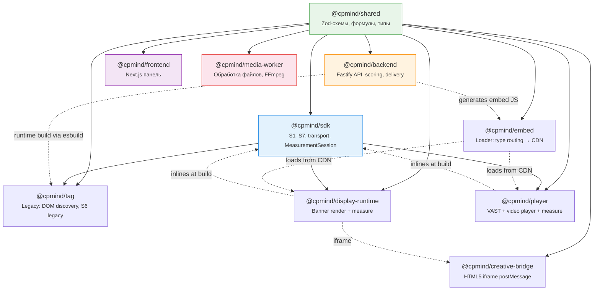

### Пояснения к графу

**Сплошные стрелки** — статические зависимости (импорт при сборке или runtime).

**Пунктирные стрелки** — динамические связи: бандл inlines SDK при esbuild-сборке; embed загружает display-runtime или player с CDN в браузере; backend вызывает esbuild JS API для сборки tag bundle.

**Build-time только** (`@cpmind/shared` → `@cpmind/tag`): shared используется как devDependency — только типизация, в выходной бандл не попадает.

### Порядок сборки (monorepo)

```
shared → sdk → backend
                tag (esbuild IIFE)
                display-runtime (esbuild IIFE)
                player (esbuild IIFE)
                embed (esbuild IIFE)
                creative-bridge (esbuild IIFE)
                frontend (next build)
                media-worker (tsc)
```

---

## Инфраструктура

### Docker Compose (production)

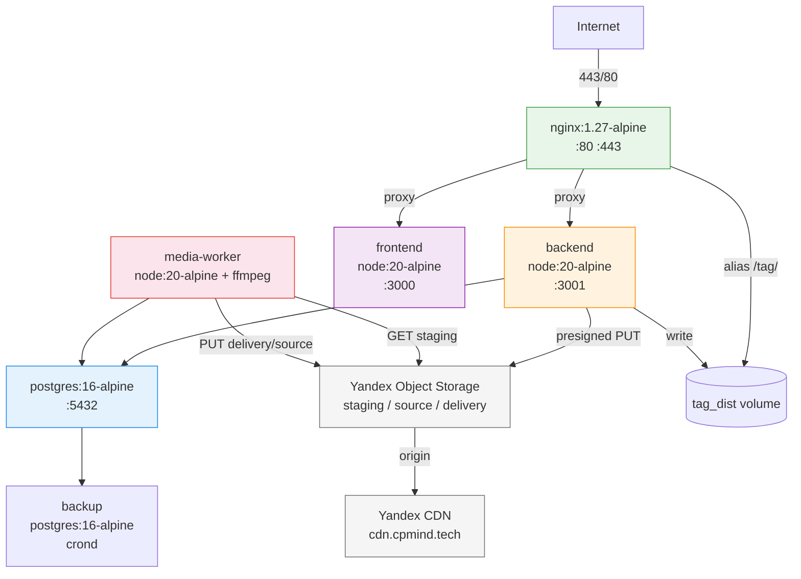

**Сеть:** все контейнеры в изолированной Docker-сети `internal` (bridge). Наружу экспонирует только NGINX через порты 80 и 443.

**Порядок запуска через healthcheck-цепочку:**
```
postgres (healthy)
    ↓
backend (healthy) + media-worker
    ↓
frontend (healthy)
    ↓
nginx
```

**Volumes:**
- `postgres_data` — данные PostgreSQL
- `tag_dist` — скомпилированные JS-файлы legacy tag (backend пишет, nginx читает)
- `./backups` — pg_dump дампы на хосте
- `tmpfs /tmp/cpmind-worker:size=10g` — RAM-диск для media-worker (видеообработка)

**media-worker:** `stop_grace_period: 60s` — при SIGTERM даётся 60 секунд на завершение текущего job. `USER cpmind` — non-root.

### Yandex Cloud Object Storage

Три бакета с разными политиками доступа:

| Бакет | ACL | Lifecycle | Назначение |
|---|---|---|---|
| `cpmind-upload-staging` | private | expire 2 дня | Временное хранение файлов до обработки |
| `cpmind-source-assets` | private | нет | Архив оригинальных файлов |
| `cpmind-delivery-assets` | public read | нет | CDN origin для обработанных ассетов |

**IAM сервисные аккаунты:**
- `cpmind-backend-signer` — роль `storage.uploader` на staging: генерирует presigned PUT URLs для браузерной загрузки
- `cpmind-media-worker` — `storage.viewer` на staging + `storage.uploader` на source/delivery

**Известное ограничение:** `storage.uploader` не включает DELETE → media-worker получает 403 при попытке удалить обработанный файл из staging. Файлы удаляются lifecycle rule через 2 дня. Fix: добавить `storage.editor` в `iam.tf`.

### SSL и сертификаты

Let's Encrypt wildcard-сертификат для всех четырёх доменов. Автообновление через certbot + `scripts/renew-certs.sh` (03:30 UTC). Все четыре домена обслуживаются одним физическим сервером — NGINX разделяет по SNI.

### Бэкапы

`pg_dump` через crond (backup-контейнер), 02:00 UTC, ротация 30 дней, путь `/backups/` на хосте.

---

## NGINX и доменная модель

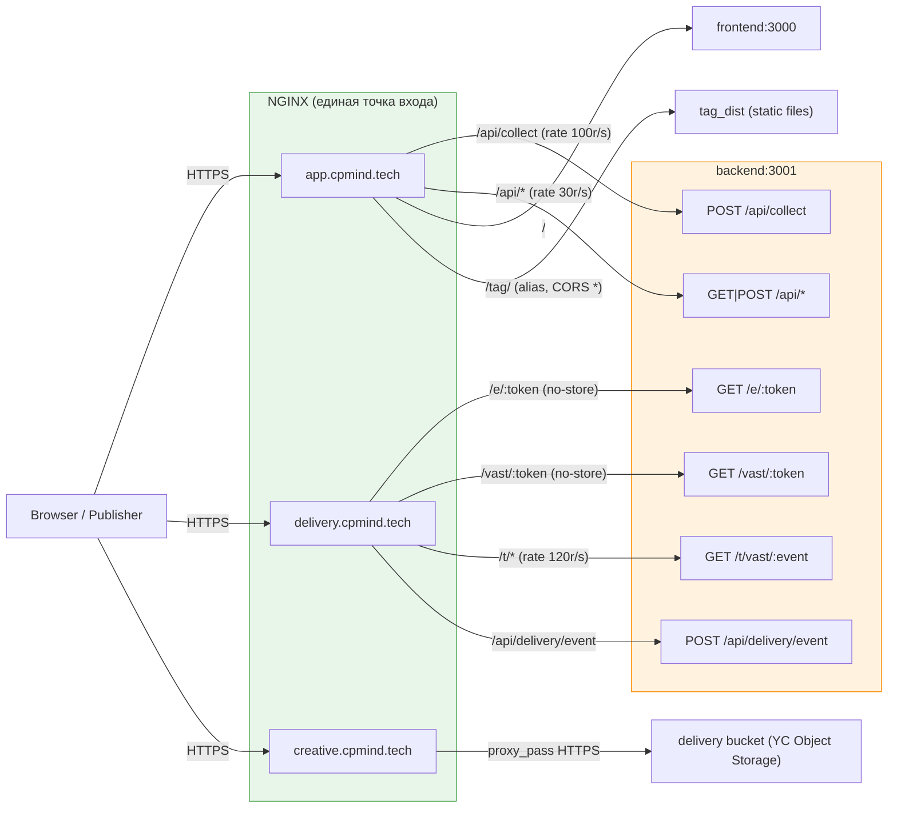

**Rate limiting zones:**

| Zone | Rate | Burst | Endpoint |
|---|---|---|---|
| `beacon` | 100 r/s | 200 | `/api/collect` |
| `api` | 30 r/s | 60 | `/api/*` панельный |
| `delivery` | 60 r/s | 30–120 | embed, VAST, tracking |

**`creative.cpmind.tech`** — изолированный origin для HTML5 iframe. Отличия от других vhost: нет `X-Frame-Options` (должен грузиться в iframe), `CSP: connect-src 'none'` (kreativ не может делать сетевые запросы), `frame-ancestors: *`, `Referrer-Policy: no-referrer`.

**`delivery.cpmind.tech`** — все responses `Cache-Control: no-store` (персонализированы по token, каждый запрос генерирует новый adSessionId).

---

## Hosted Creative Delivery — полный flow

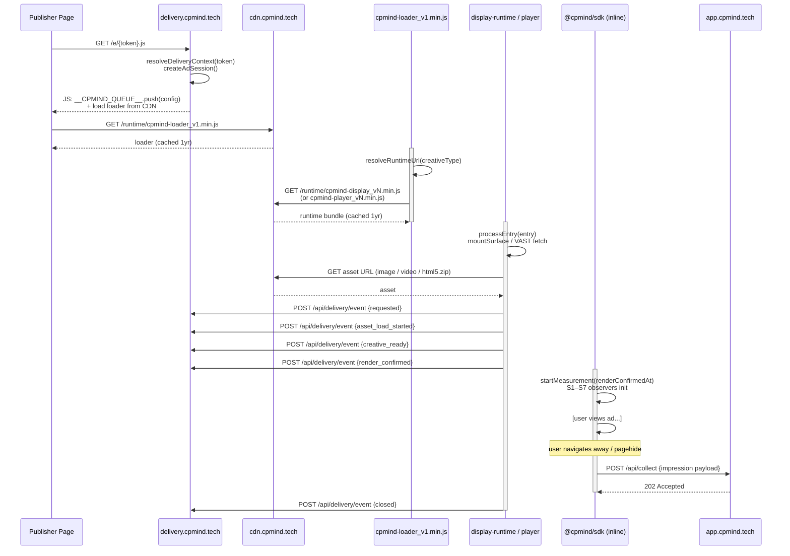

### Embed Script: что генерирует backend

При `GET /e/{token}` backend (`services/delivery/embed.ts`):

1. `resolveDeliveryContext(token)` — загружает placement + pinned/latest ready creative version + assets + tagConstants + deliveryRuntimeConfig
2. `createAdSession()` — создаёт запись в `ad_sessions`, генерирует `adSessionId`
3. Генерирует JS-код:

```javascript
(function() {
  'use strict';
  // Монтирует div нужного размера в document.body
  var el = document.createElement('div');
  el.style.width = '{width}px'; el.style.height = '{height}px';
  document.body.appendChild(el);
  // Помещает конфиг в очередь
  window.__CPMIND_QUEUE__ = window.__CPMIND_QUEUE__ || [];
  var cfg = { /* DeliveryRuntimeConfig: adSessionId, tagConstants, VAST URL, ... */ };
  cfg.container = el;
  window.__CPMIND_QUEUE__.push(cfg);
  // Загружает loader один раз
  if (!window.__CPMIND_LOADER__) {
    window.__CPMIND_LOADER__ = true;
    var s = document.createElement('script');
    s.src = '{CDN_BASE_URL}/runtime/cpmind-loader_v1.min.js';
    s.async = true;
    document.head.appendChild(s);
  }
})();
```

### Loader: маршрутизация по типу

`cpmind-loader_v1.min.js` (этот пакет — `@cpmind/embed`):

```
banner_static | banner_gif | banner_html5 → cpmind-display_v{N}.min.js
video_creative                             → cpmind-player_v{N}.min.js
```

Дедупликация: Set + DOM-проверка → один runtime бандл для всех одинаковых типов на странице.

### Display Runtime Flow

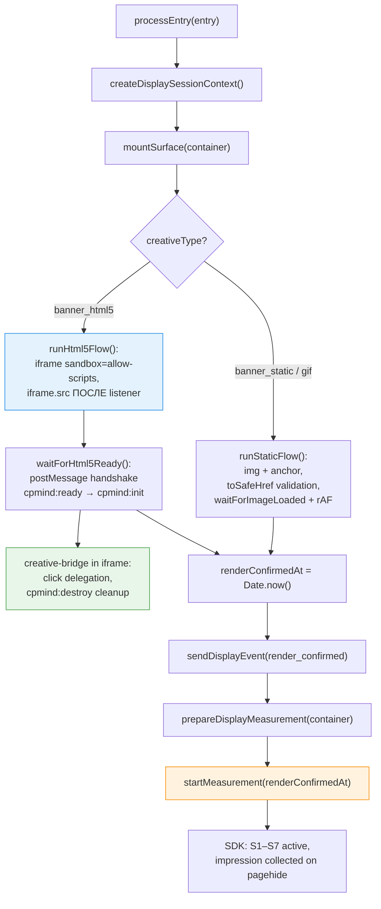

**HTML5 Creative Bridge (`@cpmind/creative-bridge`):**
- Инжектируется media-worker'ом в `<head>` index.html HTML5-бандла
- Выполняется внутри `<iframe sandbox="allow-scripts">` без `allow-same-origin`
- `event.origin === 'null'` (opaque origin) — валидация только через `event.source === window.parent`
- Перехватывает клики → делегирует хосту через `cpmind:click`
- AbortController cleanup при `cpmind:destroy`

### Player Flow (Video)

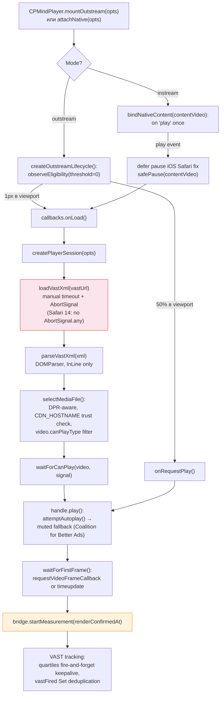

**VAST URL** (`GET /vast/{token}`): генерирует полный VAST 4.3 InLine XML с tracking URL'ами вида `/t/vast/{event}?sid={adSessionId}`. Tracking пиксели (`GET /t/vast/:event`) обновляют timestamp-поля в `ad_sessions` через COALESCE (первое событие авторитетно).

---

## Поток измерения и скоринга (Legacy Tag)

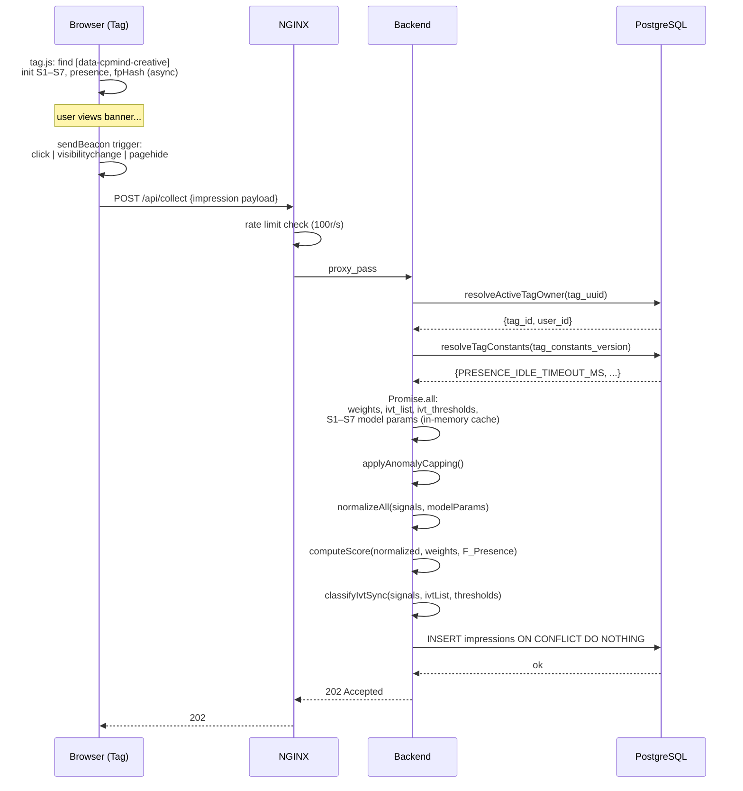

**Сегментация при простое:** если пользователь не взаимодействует ≥60 сек, тег отправляет промежуточный сегмент с тем же `session_group_id` и `segment_index+1`, сбрасывает накопители S1–S7. Последующая активность → новый сегмент.

---

## Upload и Media Processing Pipeline

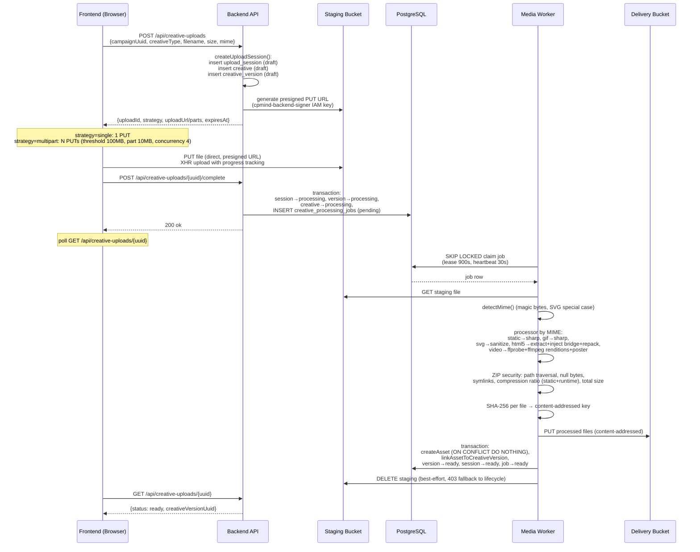

### Media Worker: обработка по типу

| MIME | Процессор | Выходные файлы | Роли |
|---|---|---|---|
| `image/jpeg`, `image/png`, `image/webp` | sharp | 1 оптимизированное изображение | `source` |
| `image/gif` | sharp | 1 оптимизированный GIF | `source` |
| `image/svg+xml` | sanitize | 1 SVG | `source` |
| `application/zip` (HTML5) | unzip + inject bridge + repack | 1 ZIP с bridge | `source` |
| `video/*` | ffprobe + ffmpeg | N renditions (H.264) + 1 poster (JPEG) | `primary`, `rendition_*`, `poster` |

**ZIP Security для HTML5 (многоуровневая):**

```
✗ Path traversal     (resolve check: must start with destDir/)
✗ Null bytes in path (entryPath.includes('\0'))
✗ Absolute paths     (normalize check)
✗ Symlinks           (unix mode: (unixMode & 0xf000) === 0xa000)
✗ ZIP bomb (static)  (compressedSize → decompressedSize ratio > 50)
✗ ZIP bomb (runtime) (streaming ratio check per-chunk)
✗ Total size         (> 100MB decompressed)
✗ Too many files     (> 500 entries)
```

**PostgreSQL queue SKIP LOCKED:**

```sql
WITH candidate AS (
    SELECT id FROM creative_processing_jobs
    WHERE status = 'pending' AND available_at <= NOW() AND attempts < max_attempts
    ORDER BY available_at ASC, created_at ASC
    FOR UPDATE SKIP LOCKED LIMIT 1
)
UPDATE creative_processing_jobs SET
    status = 'processing', locked_by = $1,
    lease_expires_at = NOW() + interval '$2 ms',
    heartbeat_at = NOW(), attempts = attempts + 1
FROM candidate WHERE id = candidate.id
RETURNING *
```

Lease + heartbeat (HEARTBEAT_MS < LEASE_MS — инвариант): при потере lease processing прерывается через AbortController. Recovery loop пересчитывает просроченные leases каждые `max(30s, min(LEASE_MS/2, HEARTBEAT_MS*2))`.

---

## Pipeline расчёта Score

```mermaid
flowchart TD
    A["POST /api/collect<br/>ImpressionPayload"] --> B["Zod-валидация"]
    B -->|"422"| ERR1["error response"]
    B --> C["resolveActiveTagOwner(tag_uuid)<br/>→ tag_id + user_id, оба isActive"]
    C -->|"422"| ERR1
    C --> D["resolveTagConstants(tag_constants_version)<br/>→ PRESENCE_IDLE_TIMEOUT_MS"]
    D -->|"422"| ERR1
    D --> E

    subgraph parallel ["Promise.all (parallel)"]
        E1["weights config\n(in-memory cache)"]
        E2["IVT list\n(in-memory cache)"]
        E3["IVT thresholds\n(in-memory cache)"]
        E4["S1 WeibullParams\nby device×creative"]
        E5["S3 LogisticParams\nby device×creative"]
        E6["S4 Config λ/T_ref\nby device_creative"]
        E7["S5 LogisticParams\nby device_type"]
        E8["S6 LogisticParams\nby device×skippable (null for banner)"]
        E9["S7 Thresholds\nby device_type"]
    end

    E --> parallel
    parallel --> F["applyAnomalyCapping()\nstructuredClone, не мутирует входной объект"]
    F --> G["normalizeAll(signals, modelParams)\nS1 Weibull CDF, S2 linear,\nS3 logistic, S4 nonlinear,\nS5 logistic, S6 logistic (null→null),\nS7 quantile"]
    G --> H["computeEffectiveWeights(weights, nullSignals)\nперераспределение S3=null,\nS6=null для баннеров"]
    H --> I["F_Presence check\ntime_since_last_event_ms > PRESENCE_IDLE_TIMEOUT_MS → 0"]
    I --> J["CPMind Score =\nΣ(Si × wi) × F_Presence\n→ [0, 100]"]
    J --> K["Флаги подозрительности:\nno_events, tab_mostly_hidden,\nanomaly_duration, is_suspicious"]
    K --> L["classifyIvtSync(signals, ivtList, thresholds)\nGIVT early return | SIVT rules\n→ verdict, category, confidence, score_reliable"]
    L --> M["INSERT impressions\nON CONFLICT (impression_id) DO NOTHING\n→ 202 Accepted"]

    style parallel fill:#f0f4ff,stroke:#90caf9
    style L fill:#fce4ec,stroke:#e53935
```

**Latency:** ~5 мс p50, ~19 мс p95 на `/api/collect` при текущей нагрузке. Promise.all по всем 9 кэшированным параметрам — нулевой overhead к latency.

---

## Сигналы S1–S7 и F_Presence

### S1 — Time-in-View (вес 0.30 banner / 0.15 video)

Суммарное время, когда ≥75% пикселей баннера находилось в viewport. Порог 75%/2s — строже IAB MRC (50%/1s): научные данные (Zhang & Chen 2015, Uhl et al. 2020, n=350k+) показывают, что стандарт MRC занижает порог реального восприятия.

**Нормализация:** Weibull CDF `F(t) = 1 − exp(−(t/λ)^k)`. MLE через Newton-Raphson. 9 сегментов: `{desktop|mobile|tablet} × {static|animated|video}`. Fallback: `k=1.0, λ=5.0`.

**Реализация:** `IntersectionObserver`, thresholds `[0, 0.75, 1.0]` из `S1_VIEWPORT_THRESHOLDS`.

### S2 — Share of Screen (вес 0.20 / 0.10)

Средняя доля viewport, занятая баннером. Сэмплирование каждые 500 мс через `getBoundingClientRect`.

### S3 — Scroll Velocity (вес 0.15 / 0.10)

Паттерн скролла в ±300px от баннера. `null` при cross-domain iframe (нет `window.scrollY` родителя).

**Нормализация:** логистическая регрессия, 8 коэффициентов β0..β7, z-score. 9 сегментов. Fallback: нулевые коэффициенты → S3=50.

**Реализация:** rAF-throttled, алгоритм Welford для бегущего среднего.

### S4 — Tab Activity (вес 0.15 / 0.10)

Активность вкладки с учётом штрафа за переключения.

**Нормализация:** `S4 = clamp(activeRatio × 100 × exp(−λ×n) × min(1, avgSession/T_ref), 0, 100)`. 5 сегментов: `desktop_banner`, `mobile_banner`, `desktop_video`, `mobile_video`, `default`. Fallback: `λ=0.08, T_ref=5000ms`.

**Реализация:** `document.visibilitychange`. `computeActiveTimeMsInRange` из `visibilityStateHistory` — отсчёт строго от `timestampStart`, не от загрузки страницы.

### S5 — Interaction Events (вес 0.15 / 0.10)

Desktop: клик, hover-duration, hover-count, cursor-proximity, cursor-entropy. Mobile: клик, zoom, tap, swipe.

**Нормализация:** логистическая регрессия, 2 сегмента: `desktop`, `mobile_tablet`. Прокси-метка: `y=1` если `clicked OR hoverDurationMaxMs >= p75`.

### S6 — Video Engagement + Audibility (вес 0.00 banner / 0.40 video)

19 полей: `play_initiated`, `quartile_25/50/75`, `completion`, `completion_rate_pct` (непрерывный %), `pause_initiated`, `skipped`, `replay_count`, `muted_status` (muted/unmuted/mixed), `volume_level`, `audio_connection`, `audible_time_sec`, `duration_sec`, `audible_quartile_*`, `muted_throughout`, `unmuted_by_user`.

**Нормализация:** логистическая с interaction term `completionZ × audibleZ`. 6 сегментов: `{desktop|mobile|tablet} × {skippable|non_skippable}`. `S6=null` для баннеров — вес перераспределяется. Инвариант: `weights.s6 === 0` для banner конфига (enforced в `activateWeightsConfig`).

**S6 Accumulator** (`@cpmind/sdk`): pure state machine без DOM-зависимостей. `audibleTimeStart` — timestamp начала audible-периода (аккумулируется при pause/ended/volumechange). `replay_count` инкрементируется при `seeked(newTime < lastSeekTime - 0.5s)`.

### S7 — Page Context (вес 0.05 / 0.05)

Позиция баннера (ATF/BTF), высота страницы, конкурирующие баннеры в viewport, persistence видимости.

**Нормализация:** квантильная. `S7 = positionScore + clutterPenalty + persistenceBonus`. 3 сегмента по device_type. Fallback: `DEFAULT_S7_THRESHOLDS` per device.

### F_Presence — мультипликатор присутствия

Бинарный (0/1). `0` если `time_since_last_event_ms > PRESENCE_IDLE_TIMEOUT_MS` на момент финализации. Значение синхронизировано между тегом (таймер сегментации) и backend (расчёт) через одну версию констант — не дублируется. Обнуляет Score при заброшенных открытых вкладках.

### Автоматическая рекалибровка моделей (cron)

```mermaid
gantt
    title Еженедельный/ежемесячный cron (UTC)
    dateFormat  HH:mm
    axisFormat  %H:%M

    section Воскресенье
    S1 Weibull MLE (weekly)     :04:00, 1h
    S3 Logistic IRLS (weekly)   :05:00, 1h
    S5 Logistic IRLS (weekly)   :06:00, 1h
    S6 Logistic IRLS (weekly)   :07:00, 1h

    section 1-е число месяца
    S4 λ/T_ref fit (monthly)    :06:00, 1h
    S7 Quantile fit (monthly)   :08:00, 1h
```

Все модели: выборка 30 дней (S7: 60 дней), `is_suspicious=false`, MIN_SAMPLE_SIZE на сегмент. Новые конфиги создаются inactive, не заменяют активные автоматически. Hold-out 20% для S3/S5/S6. Удаление старых конфигов через `deletion_scheduled_at` (soft delete, 60 мин).

---

## Формула CPMind Score

```
Banner:
CPMind_Score = (S1×0.30 + S2×0.20 + S3×0.15 + S4×0.15 + S5×0.15 + S7×0.05) × F_Presence
               [S6=null → его вес 0.00, перераспределение не применяется]

Video:
CPMind_Score = (S1×0.15 + S2×0.10 + S3×0.10 + S4×0.10 + S5×0.10 + S6×0.40 + S7×0.05) × F_Presence
```

**Перераспределение весов:** S3=null (cross-domain iframe) — `computeEffectiveWeights` распределяет его вес пропорционально между остальными. Сумма весов всегда 1.0.

| Score | Интерпретация |
|---|---|
| 0–20 | Некачественный показ |
| 20–40 | Слабый показ |
| 40–60 | Средний показ |
| 60–80 | Хороший показ |
| 80–100 | Отличный показ |

---

## Калибровка исторических импрешенов

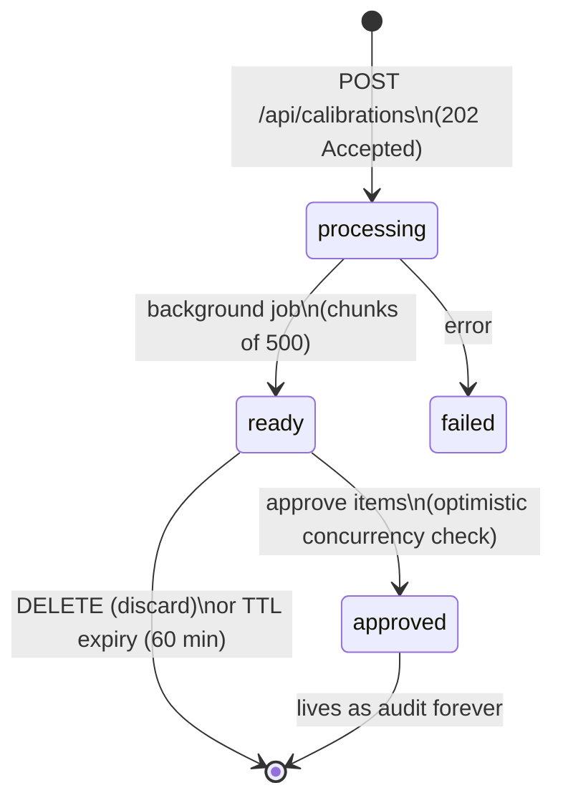

**Что пересчитывается:** только `score_final` и `weights_version`. Сырые сигналы, нормализованные, F_Presence, флаги — не зависят от весов, не пересчитываются.

**Режимы выборки:** `ids` (конкретные impression IDs), `session_groups` (целые сегменты), `filter` (те же параметры что в основном списке). Ownership принудительно AND'ится во всех режимах — IDOR защита. Тест: свой + чужой id → `totalItems: 1`.

**Optimistic concurrency:** перед UPDATE проверяется `score_final = previousScoreFinal`. Конфликт → 409 по элементу, без блокировки остальных.

---

## IVT — детекция невалидного трафика

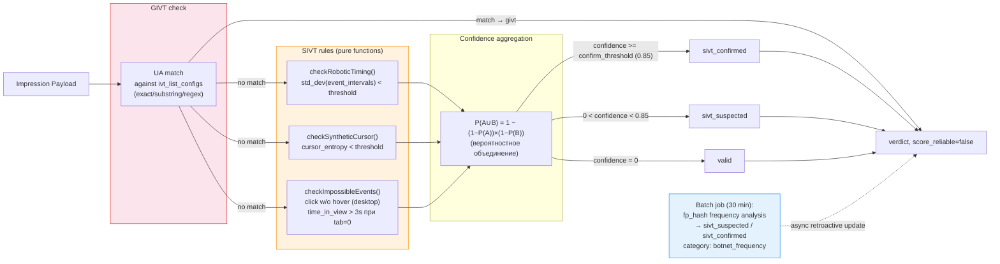

**Device fingerprint (`fp_hash`):** SHA-256(canvas + UA + screen + timezone + language) → первые 32 hex символа (128 бит). Вычисляется асинхронно (fire-and-forget), nullable. Юридически чист по 152-ФЗ/GDPR — необратимый хэш, не PII.

**`score_reliable=false`** при любом `ivt_verdict != 'valid'` — не обнуляет Score математически, помечает как недостоверный.

**Стратегическая развилка §7:** текущая реализация — Path A (поведенческая + fp_hash). Path B (серверный IP → CIDR mathing, UA vs device_type mismatch из заголовков) — деферред.

---

## База данных

### ER-диаграмма (упрощённая)

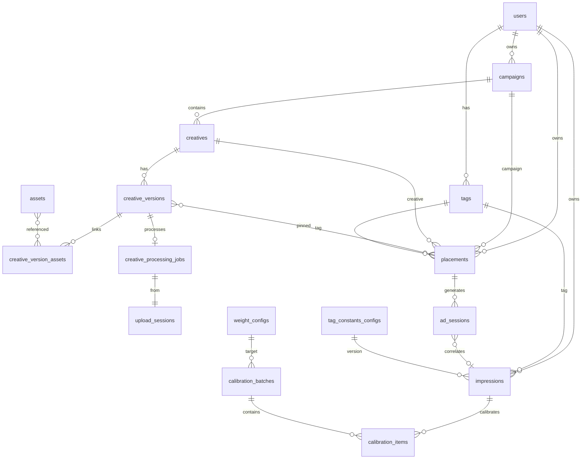

### Ключевые таблицы

**`impressions`** — основная единица хранения. Retention: 90 дней (job 03:00 UTC). Связанные `calibration_items` → ON DELETE CASCADE.

**`ad_sessions`** — lifecycle рекламной сессии (hosted creative). Содержит полный набор timestamp-полей: `requestedAt`, `assetLoadStartedAt`, `creativeReadyAt`, `renderConfirmedAt`, VAST-тайминги (`vastImpressionAt`, `videoStartedAt`, `firstQuartileAt`, `midpointAt`, `thirdQuartileAt`, `completedAt`, `skippedAt`), `errorAt`/`errorCode`, `finalizationReason`. COALESCE при обновлении — первое событие каждого типа авторитетно.

**`creative_processing_jobs`** — PostgreSQL SKIP LOCKED очередь. Ключевые поля: `upload_session_id`, `creative_version_id`, `processing_profile_version`, `status`, `attempts`/`max_attempts`, `locked_by`, `lease_expires_at`, `heartbeat_at`, `available_at`.

Индексы:
- Partial `(available_at, created_at) WHERE status='pending'` — эффективный SKIP LOCKED claim
- Partial `(lease_expires_at) WHERE status='processing'` — recovery expired leases

**`delivery_runtime_configs`** — таймауты player. Одна активная версия (partial unique `WHERE is_active=true`). Seed: `v1.0` при migration 0020.

**`tag_constants_configs`** — множество активных версий одновременно (разные клиенты). Версии неизменяемы после создания. Деактивация удаляет физический файл и блокирует приём (`422`) без grace-периода.

**`weight_configs`** — ровно одна активная на каждый `config_type` (`banner`/`video`). Partial unique `(config_type) WHERE is_active=true`. Инвариант: `weights.s6 === 0` для banner конфигов.

### Индексы на `impressions`

```
impression_id (UNIQUE)
session_group_id, created_at, campaign_id, creative_id
device_type, is_suspicious, score_final, s6_normalized
publisher_domain, tag_id, user_id
(user_id, created_at) composite
tag_constants_version, ivt_verdict, fp_hash
ad_session_id WHERE NOT NULL
measurement_mode, creative_version_id WHERE NOT NULL
```

### Retention

| Данные | Retention | Механизм |
|---|---|---|
| `impressions` | 90 дней | job 03:00 UTC |
| `calibration_items (pending)` | 60 мин | cleanup каждые 15 мин |
| `s*_configs (inactive, scheduled)` | 60 мин после планирования | `scheduled_deletion.ts` каждые 15 мин |
| `assets (unreferenced)` | 45 дней | `asset_gc.ts` 03:30 UTC |
| `weight_configs`, `users`, `tags`, `tag_constants_configs` | бессрочно | нет автоудаления |
| pg_dump | 30 дней | ротация в backup контейнере |

---

## Безопасность

**JWT:** httpOnly cookie `cpmind_token`, TTL 7 дней. Payload `{uuid, id, role}`. `requireAuth` проверяет `isActive` из БД на каждый запрос — деактивация немедленно отзывает доступ.

**Пароли:** bcrypt (rounds=10). Constant-time compare даже при несуществующем логине (dummy hash) — защита от timing-атаки user enumeration.

**CORS по группам:**

| Пути | Origin | Credentials |
|---|---|---|
| `/e/*`, `/vast/*`, `/t/*`, `/api/delivery/*` | `*` | false |
| `/api/collect` | reflect origin | true |
| Всё остальное | reflect origin | true |

**HTML5 Creative isolation:** `sandbox="allow-scripts"` без `allow-same-origin`. Same-Origin Policy изолирует iframe от host DOM. `CSP: connect-src 'none'` на `creative.cpmind.tech` — сетевые запросы из iframe заблокированы на уровне браузера. postMessage валидация только через `event.source === window.parent` (event.origin всегда 'null' в opaque sandbox).

**Media validation:** MIME detection по magic bytes (не по расширению/Content-Type). ZIP security — многоуровневая защита от ZIP bomb, path traversal, symlink escape. VAST media URL — CDN_HOSTNAME trust check в player (baked-in при сборке).

**IDOR:** владелец из JWT, не из URL/query. Чужой ресурс → 404. В калибровке: ownership AND'ится во всех режимах выборки.

**Известный непокрытый риск:** `tag_uuid` виден в HTML legacy страниц. Отправка показов под чужим UUID возможна — засоряет данные, не даёт доступа к чтению. Принятый риск. В hosted flow `delivery_token` — 192 бит непредсказуемая энтропия (randomBytes(24).base64url).

---

## Технический стек

| Слой | Технология | Версия |
|---|---|---|
| Runtime | Node.js | 20 LTS |
| Package manager | pnpm workspaces | 9.15.2 |
| Language | TypeScript | 5.4.x |
| API сервер | Fastify | 4.28.x |
| ORM | Drizzle ORM | 0.31.x |
| Database | PostgreSQL | 16 |
| Frontend | Next.js App Router | 14.2.x |
| Таблица | TanStack Table | v8.17.x |
| Bundler (IIFE) | esbuild | 0.21.x |
| Media processing | sharp + ffmpeg | — |
| ZIP | unzipper + archiver | — |
| MIME detection | file-type | 19.x |
| Валидация | Zod | 3.23.x |
| Логирование | Pino | 9.x |
| Cron | node-cron | 3.0.x |
| HTTP client | fetch (built-in) | — |
| Object Storage | @aws-sdk/client-s3 | 3.600.x |
| Web server | NGINX | 1.27-alpine |
| Container | Docker + Compose | — |
| CI/CD | GitHub Actions | — |
| CDN | Yandex CDN | — |

---

## Монорепо: конфигурация

### `tsconfig.base.json`

```json
{
  "compilerOptions": {
    "target": "ES2022",
    "strict": true,
    "exactOptionalPropertyTypes": true,
    "noUncheckedIndexedAccess": true,
    "noImplicitOverride": true,
    "forceConsistentCasingInFileNames": true,
    "resolveJsonModule": true,
    "declaration": true,
    "declarationMap": true,
    "sourceMap": true,
    "esModuleInterop": true,
    "skipLibCheck": true
  }
}
```

`exactOptionalPropertyTypes` → паттерн `...(val !== undefined && { key: val })` вместо прямого присваивания. `noUncheckedIndexedAccess` → `arr[0]` возвращает `T | undefined`, защита от необъявленных индексов.

### Пакетные особенности

**`@cpmind/shared`:** единственная production-зависимость — Zod. `sideEffects: false` — tree-shaking безопасен.

**`@cpmind/sdk`:** компилируется через `tsc` (не esbuild), потребляется как library. `sideEffects: false`. Инлайнится в bundle-потребители при их esbuild-сборке.

**`@cpmind/tag`:** только devDependencies. Выходной бандл — браузерный IIFE, ~31 KB. Собирается через esbuild `globalName: 'CPMindTag'`.

**`@cpmind/embed`, `@cpmind/display-runtime`, `@cpmind/player`, `@cpmind/creative-bridge`:** браузерные IIFE через esbuild. `TAG_BUILD_TARGETS` из `@cpmind/shared` — Chrome 90+, Firefox 90+, Safari 14+, Edge 90+. `legalComments: 'none'`. `CDN_HOSTNAME` и версии baked-in через `define`.

**`@cpmind/backend`:** `type: module` (ESM). `esbuild` — production dependency (runtime-сборка tag bundle). Drizzle Kit в devDependencies.

**`@cpmind/media-worker`:** `tsc` (не esbuild). FFmpeg — системный бинарный (`apk add ffmpeg`). `tmpfs /tmp/cpmind-worker:size=10g` в Docker Compose.

**`@cpmind/frontend`:** `output: standalone` в `next.config.mjs`. `NEXT_PUBLIC_BACKEND_URL=""` при production build — relative URLs через NGINX proxy.

---

## Известные ограничения

**Один сервер — нет горизонтального масштабирования.** При текущей нагрузке запас значительный (p95 latency ~19 мс на `/api/collect`). При росте — потребуется load balancer + множество инстансов backend.

**Нет очереди сообщений.** `/api/collect` синхронен. Media processing — через PostgreSQL SKIP LOCKED (не Kafka/RabbitMQ). При высоком объёме загрузок — ограничение на параллельность определяется `WORKER_CONCURRENCY` одного инстанса. Горизонтальное масштабирование media-worker корректно работает с SKIP LOCKED.

**VAST: только InLine.** Wrapper chains не поддерживаются. OMID verification scripts парсятся, не исполняются.

**Player: только progressive delivery.** HLS/DASH не поддерживаются.

**Legacy tag uuid visibility.** Принятый риск: tag_uuid виден в HTML источнике. Hosted flow лишён этой проблемы — delivery_token непредсказуем.

**DELETE 403 для staging bucket.** `storage.uploader` IAM роль не включает DELETE. Файлы удаляются lifecycle rule через 2 дня. Fix: добавить `storage.editor` в `iam.tf`.

**Node.js ≥22 requirement.** AWS SDK v3 после января 2027 требует Node 22. Базовые образы используют `node:20-alpine`. Необходимо обновление до 2027.